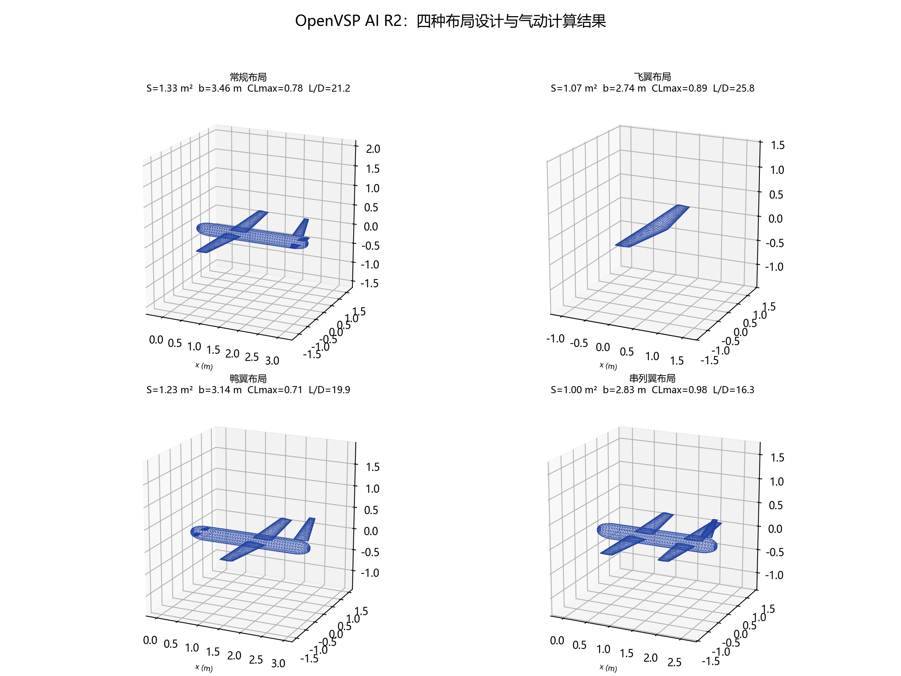

# OpenVSP AI R2

**OpenVSP 3.51.3 简体中文 AI 辅助飞行器概念设计 / OpenVSP AI-assisted concept design overlay**

> 研究型、概念设计辅助工具，不是适航、结构强度、飞行放行或试飞工具。所有气动与稳定性结果必须经过独立验证。

本项目在 OpenVSP 3.51.3 源码基础上增加：

- 简体中文 AI 设计面板（OpenAI 兼容 API；无 Key 可离线规则设计）；
- 自然语言/文档输入 → 机翼/尾翼/机身 sizing → OpenVSP 建模 → VSPAERO → 稳定性检查 → Word 报告；
- 常规、飞翼、鸭翼、串列翼四类布局；
- 机身规则、翼根/平尾/鸭翼/后翼根部按机身宽度裁剪；
- 经验设计准则、三态/证据契约、独立 run 目录、静稳定多轮优化；
- MCP stdio 服务器和内置报告模板。



## 当前状态

- **研究/原型状态**：已通过 116 项自动化回归测试，但这些测试不是 62 项软件验收用例（AT-001～062）通过。
- 可靠性改造正在按 M0–M4 推进；当前报告会显式显示 `evidence_status=incomplete`、`recommendation_status=analysis_only`。
- 不包含 OpenVSP 二进制、Python `_vsp.pyd`、OEM/商业翼型数据库或任何 API Key。
- 不包含 Profili 数据库；只支持读取用户本机已授权安装的本地缓存。

## 目录结构

```text
ai/                       AI 设计后端（Python）
  ai_design/              需求、sizing、OpenVSP/VSPAERO、报告、准则、run store
  tests/                  自动化回归测试
  templates/              Word 报告模板
  ai_design_agent.py      CLI 入口
mcp/                      MCP stdio 服务器和安装脚本
patches/                  OpenVSP GUI 修改补丁和源文件
installer/                Inno Setup 安装程序脚本
docs/                     中文设计/构建/可靠设计文档
examples/                 离线配置示例
scripts/                  构建、基线清单和 Profili 本地导入脚本
validation/               轻量验证结果与四布局截图
```

## Windows 安装程序

`installer/OpenVSP-AI-R2.iss` 是 Inno Setup 6 脚本，用于把便携版目录构建为安装程序。安装器会：

- 安装到 `%LOCALAPPDATA%\Programs\OpenVSP AI R2`；
- 写入用户环境变量 `OPENVSP_R2_ROOT`、`OPENVSP_ROOT`、`OPENVSP_PYTHONPATH` 等；
- 生成 `mcp\install_context.ini`，记录安装目录、Python 和 MCP Server 路径；
- 下次打开 **MCP调用** 时，提示词会自动读取这些路径；
- 保留其他电脑的通用定位步骤，提示词复制到别的机器后仍可重新解析。

构建：

```powershell
powershell -ExecutionPolicy Bypass -File installer\build_installer.ps1
```

安装包不包含在 Git 仓库中，生成后位于 `dist\installer\`。

## 环境要求

- Windows 10/11
- OpenVSP 3.51.3（需要 Python API 和 VSPAERO）
- Python 3.13（建议；至少 Python 3.11）
- Visual Studio 2022 + CMake（仅从源码重建 GUI 时需要）
- 可选：DeepSeek / GLM / Kimi / OpenAI 或兼容服务 API Key

## 快速开始（仅 AI 后端 / 无 GUI）

```powershell
git clone https://github.com/wccjitou-lgtm/openvsp-ai-r2.git
cd openvsp-ai-r2
python -m pip install -r ai/requirements.txt
$env:OPENVSP_ROOT = "C:\OpenVSP-3.51.3-win64"
python aii_design_agent.py --offline --config examples\offline_config.json
```

离线模式不需要 API Key，会用规则 sizing + OpenVSP/VSPAERO 生成模型、指标和 Word 报告。API Key 仅在本机 DPAPI 配置中使用，绝不写入仓库。

## 构建 GUI（AI 菜单）

1. 获取 OpenVSP 3.51.3 源码（本仓库不包含完整 OpenVSP 源码）。
2. 将 `patches/source-changes/src/gui_and_draw/` 中的文件复制到对应源码目录，或用 `patches/r2-ui.patch` 打补丁。
3. 按 OpenVSP 官方构建流程用 CMake/VS2022 构建 `vsp`。
4. 将本仓库 `ai/`、`mcp/`、`docs/`、`scripts/` 放到构建产物/便携目录；设置 `OPENVSP_ROOT`。
5. 启动 `vsp.exe`，菜单栏进入 **AI辅助 → AI 设计...**。

更详细步骤见 `docs/04-开发与构建说明.md`。

## MCP

GUI 中的 **MCP调用** 按钮只显示一段可直接复制给 Agent / Harness 的提示词，不再展示安装教程或目录操作。

```powershell
python mcp\install_mcp.py --print-command
```

MCP 服务器提供建模、几何查询、VSPAERO、报告等工具；stdio 协议细节见 `docs/03-MCP服务器使用说明.md`。

## 可靠设计与验收资料

- `docs/reliable_design_v1/`：开发方案、验收测试规范、需求/用例/追踪矩阵；
- `docs/reliable_design_v2/`：M0 基线、M1 增量记录、静稳定多轮优化记录；
- `docs/09-Profili翼型库与AI自动选型.md`：本地翼型库接入说明；
- `docs/11-四布局设计与测试.md`：四布局结果和截图。

## 数据与隐私

- 不提交 API Key、`ai_ui.cfg`、DPAPI 密文、用户附件或生成输出；
- 不提交 Profili 商业数据库或本地缓存；
- `examples/`、`validation/` 只保留可公开的轻量样例；
- 提交前请使用 `.gitignore` 并检查 `git status`。

## 许可

- OpenVSP 相关源码/补丁：NASA Open Source Agreement 1.3，见 `LICENSE`；
- 本仓库原创的 AI/MCP/文档/脚本：MIT，见 `LICENSE-AI`；
- 组合分发时以各组件的许可和 `NOTICE.md` 为准；
- Profili 数据库/二进制不随本项目分发。

## 免责声明

本项目用于研究和概念设计辅助。VSPAERO 是低阶势流方法，不能替代 CFD、风洞、结构分析、适航或试飞。使用者对任何工程结论负责。
