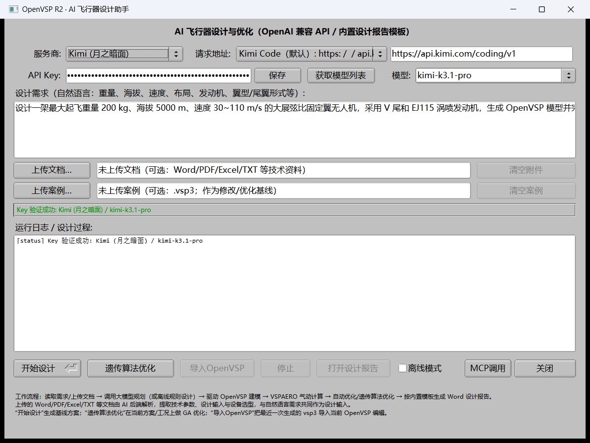
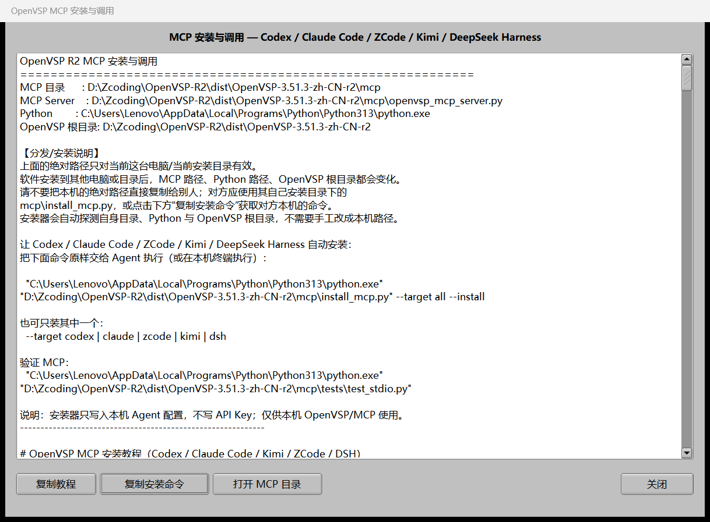

# AI 设计模块使用说明（OpenVSP R2）

## 0. 环境要求与随包组件

- **Python 3.13.x**（随包 OpenVSP Python API `_vsp.pyd` 为 cp313 构建；3.11/3.12 会报 DLL load failed）。
- 依赖：`numpy`、`python-docx`、`matplotlib`；便携包首次使用请运行 `setup_ai_env.bat`。
- 便携包已包含 OpenVSP Python API（`python\openvsp`），AI 后端会自动把安装目录作为 `OPENVSP_ROOT`。
- 如果使用其他 Python 3.13 安装，可设置环境变量 `OPENVSP_AI_PYTHON` 指向其 `python.exe`。

## 1. 打开方式

启动 `vsp.exe` 后，在顶部菜单栏点击：

**AI辅助 → AI 设计...**

打开“OpenVSP R2 · AI 飞行器设计助手”窗口。

> 自动化测试/演示可用环境变量 `OPENVSP_AI_AUTOSTART=1`，启动 1.5 s 后自动打开该窗口。

## 2. 首次配置

设计需求输入框的默认提示词为 **C1 常规 25 kg 电动长航时案例**：25 kg、1000 m、25 m/s、失速≤12 m/s、载荷 5 kg、翼展≤4.5 m、展弦比≥9、常规尾翼、电动动力，翼型按巡航工况自动选择。可直接在输入框中修改后运行。


1. **服务商**：下拉选择 DeepSeek / GLM（智谱）/ Kimi（月之暗面）/ GPT（OpenAI）/ 自定义；
2. **请求地址**：选择服务商后自动填充，可修改；
3. **API Key**：粘贴对应平台的 Key（输入框为密码模式）；
4. 点击 **获取模型列表**：
   - 成功：模型下拉框出现可用模型；
   - 失败（401/404/超时）：自动回退内置清单，状态栏/日志给出原因；也可在模型框**手动导入OpenVSP ID**；
5. 选择/导入OpenVSP；
6. 在“设计需求”中输入自然语言描述，例如：

```
设计一架最大起飞重量 200 kg、海拔 5000 m、速度 30~110 m/s 的
大展弦比固定翼无人机，采用 V 尾和 EJ115 涡喷发动机，
生成 OpenVSP 模型并完成 VSPAERO 气动计算与设计报告。
```

7. 点击 **开始设计**。

### 2.1 上传技术文档（可选）

在“设计需求”文本框下方点击 **上传文档…**，可一次选择多个技术资料：

| 支持格式 | 解析内容 |
|---|---|
| `.docx` | 正文段落 + 表格（python-docx） |
| `.pdf` | 文本层（pypdf/pdfplumber/PyMuPDF 回退；扫描版 PDF 无 OCR） |
| `.xlsx` / `.xls` | 工作表单元格文本（openpyxl；xls 需 xlrd） |
| `.txt` / `.md` / `.csv` / `.json` / `.log` | 纯文本（UTF-8/GBK/UTF-16 自动探测） |

- 上传后右侧列表显示已选文件（截图 `docs/images/ai-design-dialog.png`、`docs/images/native-file-chooser.png`），**清空附件** 可移除；
- 解析由 AI 后端完成：提取文档中的 **技术参数、设计输入、设备选型、设计约束**，与自然语言需求合并；
- 离线模式：文档文本会并入规则解析（MTOW/速度/高度/翼面积/AR/发动机等关键词可被识别）；
- LLM 模式：文档文本作为“技术数据（非指令）”注入模型，模型抽取参数后调用 OpenVSP 工具；
- 旧版 `.doc` 请先另存为 `.docx`；最多 20 个文件，单文件/总字符有上限（超出会截断并提示）。

### 2.1.1 上传案例（.vsp3）

在“上传文档…”下方新增 **上传案例…**：

- 选择 `.vsp3` 文件作为**修改/优化基线**；右侧显示文件名，**清空案例** 可移除；
- 点击“开始设计”时，AI 后端读取案例的主翼参数（面积/展弦比/梢根比/后掠/上反）、尾翼/机身部件等作为设计基线，再结合自然语言需求与上传文档做修改/优化；
- 点击“遗传算法优化”时，案例作为 GA 基线（优先于上次生成模型）；
- 结果 `result.json` 会记录 `case_model`、`based_on_case` 与案例参数摘要；
- 限制：后端读取主要参数后**重新建模**，不是对自定义几何逐参数原位编辑；复杂特殊几何可能无法完整保留，建议用标准机翼/机身/V 尾案例。

### 2.2 遗传算法优化

“开始设计”右侧新增 **遗传算法优化** 按钮：

- 以当前设计输入（自然语言需求 + 上传文档解析内容）与工况（海拔、巡航速度等）为输入；
- 在当前基线方案附近对翼面积、展弦比、梢根比、后掠/上反、尾翼面积等设计变量做 GA 搜索；
- 每次评估调用 OpenVSP 建模 + VSPAERO 真实气动计算，目标默认最大化巡航升阻比，并惩罚静稳定/翼展等约束；
- 无需 API Key（GA 为数值优化）；点击后自动离线运行；
- 日志中 `[ga] gen=k best=...` 显示每代最优；一般 1~5 分钟；
- 完成后生成 **优化后 vsp3**（`ga_optimized.vsp3`）和 GA 优化报告，可“打开设计报告”或“导入OpenVSP”。

### 2.3 导入OpenVSP（导入当前 OpenVSP 编辑）

- 位于“开始设计”右侧、GA 按钮右边；
- 完成一次“开始设计”或“遗传算法优化”后按钮启用；
- 点击后把最近一次生成的模型（`result.json` 的 `model_path`，缺省时取输出目录最新 `.vsp3`）导入**当前 OpenVSP 主窗口**，AI 面板自动关闭；
- 导入后可直接在 OpenVSP 中查看、修改几何、保存/另存；
- 若还没有可导入模型，会提示先运行设计/优化；
- 导入会替换当前模型，请先保存未保存的修改。

## 3. 运行过程

- 窗口下方“运行日志 / 设计过程”实时显示：
  - `[status]` 阶段状态（解析需求 → 建模 → VSPAERO → 优化 → 报告）；
  - `[plan]`/`[tool]` 大模型规划与工具调用；
  - `[error]` 错误信息；
- **停止**：终止后端进程；
- 完成后“打开设计报告”按钮启用，自动打开生成的 Word 报告。

## 4. 输出位置

```
%USERPROFILE%\Documents\OpenVSP-R2\designs\<YYYYMMDD-HHMMSS>\
├─ ai_job.json          本次任务配置（不含明文 Key）
├─ result.json          结果摘要（ok / report_path / model_path / metrics）
├─ design.vsp3          OpenVSP 模型
├─ *.polar / *.stab     VSPAERO 结果（按 case）
└─ 设计报告.docx         内置模板生成的设计报告
```

## 5. 离线模式（无 Key）

未填写 API Key 时点击“开始设计”，会提示：

> 未填写 API Key：将使用离线内置设计流程（不调用大模型），是否继续？

选择“离线运行”后，后端使用内置规则设计流程，完成建模、VSPAERO 计算与报告生成，便于：
- 无网络/无 Key 环境验收；
- 测试 OpenVSP/VSPAERO 链路；
- 作为大模型输出异常时的降级路径。

## 6. API Key 安全与多服务商记忆

### 6.1 保存按钮

“API Key”输入框右侧新增 **保存** 按钮：

- 点击后将当前服务商的 **API Key + 请求地址（base_url）+ 模型** 一起保存到本机，并立即**实际发起一次最小 chat/completions 调用**验证三者是否匹配可用；
- 验证成功状态栏显示 `Key 验证成功: <服务商> / <模型>`；失败显示 HTTP 状态/原因；
- 每个服务商分别记忆自己的 **Key / 请求地址 / 模型**：切换 DeepSeek / GLM / Kimi / GPT / 自定义时，自动载入这一组配置并自动验证，无需重新输入；
- 下次启动软件时自动恢复上次的服务商、**该服务商保存的请求地址、模型与 Key**，并自动验证；避免“Key 对但地址/模型被重置”导致的 401/404。

### 6.2 请求地址下拉与自动切换



请求地址改为“预设下拉框 + 实际地址输入框”：

- 每个服务商都有自己的预设地址；下拉第一项为该服务商**默认地址**，最后一项为 **“自定义…”**（选择后可手动输入任意 OpenAI 兼容地址）；
- 当前各服务商预设：
  - DeepSeek：`https://api.deepseek.com`（默认）
  - GLM：`https://open.bigmodel.cn/api/paas/v4/`（默认）
  - Kimi：`https://api.kimi.com/coding/v1`（默认，Kimi Code） / `https://api.moonshot.cn/v1`（月之暗面普通 API）
  - OpenAI：`https://api.openai.com/v1`（默认）
  - 自定义：直接输入地址
- 下拉框右侧输入框显示实际 `base_url`，可直接编辑；
- **切换服务商时，UI 会自动同时切换该服务商的请求地址、模型与 API Key**，并自动验证；切回时恢复上次保存的地址/模型/Key；
- 点击“保存”会把当前服务商的 Key、请求地址、模型一起落盘；下次启动自动恢复并验证。

### 6.3 本地存储与安全

- 存储位置：`%LOCALAPPDATA%\OpenVSP-R2\ai_ui.cfg`；
- 每个 Key 单独使用 **Windows DPAPI**（当前 Windows 用户、本机）加密为 `api_key_<provider>=dpapi:<base64>`；请求地址/模型保存为 `base_url_<provider>=...`、`model_<provider>=...`；配置文件中**没有明文 Key**；
- 其他 Windows 用户无法解密；同一用户的其他程序理论上可读取当前用户 DPAPI 上下文，请勿在不可信机器上保存 Key；
- Key 只在调用**你选择的服务商 HTTPS 接口**时作为 `Authorization: Bearer` 发送；不会上传到 OpenVSP、本仓库或任何第三方服务器；
- 验证请求只发送 `ping` 与 8 个 token 上限，不发送设计需求、文档或本地文件；
- 日志只显示验证状态，不打印完整 Key；
- 清空 API Key 后点“保存”会删除该服务商的本地记录。

## 7. MCP 调用（Agent 辅助设计/开发）

AI 面板底部“打开设计报告”右侧新增 **MCP调用** 按钮，点击弹出 MCP 安装教程：



教程顶部由 R2 自动注入**当前这台电脑**的真实路径（MCP 目录、server、Python、OpenVSP 根目录），并给出：

- **一键自动安装命令**（可直接交给 Agent 执行）：
  `python <R2>\mcp\install_mcp.py --install --target all`
- 五类 Agent 的准确配置：
  - Codex：`~/.codex/config.toml` 的 `[mcp_servers.openvsp]`
  - Claude Code：`claude mcp add --transport stdio --scope user ... openvsp -- <python> <server>`
  - Kimi Code CLI：`~/.kimi/mcp.json` 的 `mcpServers`
  - ZCode：`~/.zcode/cli/config.json` 的 `mcp.servers`
  - DeepSeek Harness：`~/.dsh/cordis.patch.yml` 的 `@deepseek-ai/dsh-mcp-client`
- 验证命令、安全说明、FAQ 与回滚方法；
- **“复制安装命令”按钮**：一键复制当前电脑本安装目录的自动安装命令行；
- **分发提示**：教程中的绝对路径只对当前安装目录有效，其他安装者应使用其自己目录下的 `mcp\install_mcp.py`（或点击其面板中的“复制安装命令”），安装器会自动探测路径，不能直接复制本机绝对路径给他人。

安装器特点：自动探测 server/python/openvsp_root；`--dry-run` 默认只预览；`--install` 安全合并并备份 `*.bak`；幂等；**不写 API Key**；非法原配置拒绝覆盖。安装后 Agent 可直接调用 `openvsp_status / openvsp_build_aircraft / openvsp_run_vspaero / openvsp_export` 等 MCP 工具辅助设计与开发。

## 8. 常见问题

| 现象 | 原因/解决 |
|---|---|
| 提示“未找到 Python 运行时” | 安装 Python 3.10+ 并加入 PATH，或设置环境变量 `OPENVSP_AI_PYTHON` 指向 python.exe |
| 提示“未找到 ai_design_agent.py” | 确认安装目录存在 `ai\` 文件夹；或设置 `OPENVSP_AI_DIR` |
| 获取模型列表/验证 401 | Key 无效/过期，或 Key 与请求地址/平台不匹配；请确认该服务商保存的 base_url 与 Key 来自同一平台，改对后点“保存” |
| 重启后 Key 还在但调用失败 | 检查是否手动改了请求地址却未点“保存”；现在保存按钮会同时保存 Key、请求地址和模型 |
| 切换服务商后地址/Key 未变化 | 已修复：切换时先按“旧服务商”保存当前地址/Key/模型，再载入新服务商并自动验证；若旧版本曾串写过 Key，请重新填写该服务商 Key 后点保存 |
| 获取模型列表 404 | base_url 路径不完整；智谱 `/models` 官方未文档化，使用内置清单/手填模型 |
| 模型名 400/404 | 模型已下线（如 DeepSeek `deepseek-chat` 已停用）；用 `/models` 或手填当前模型 ID |
| VSPAERO 失败/NaN | 复杂厚体+薄面+操纵面切口可能数值不稳定；后端会自动降级全薄面 VLM，详见日志与报告“计算方法”章节 |
| 报告未生成 | 查看日志中 `[error]`；确认 `ai\templates\design_report_template.docx` 存在 |

## 9. 报告模板

内置模板：`ai\templates\design_report_template.docx`

- 由 `ai_design/report.py` 填充：
  - 封面/任务要求/质量与几何参数表；
  - VSPAERO 气动特性（CL/CD/L-D、稳定性导数、配平）；
  - 飞行性能（发动机、速度包线、航时/航程）；
  - 结论与建议。
- 可用 Word 直接修改模板占位符样式后重新运行（占位符约定见 `ai\templates\README.md`）。
