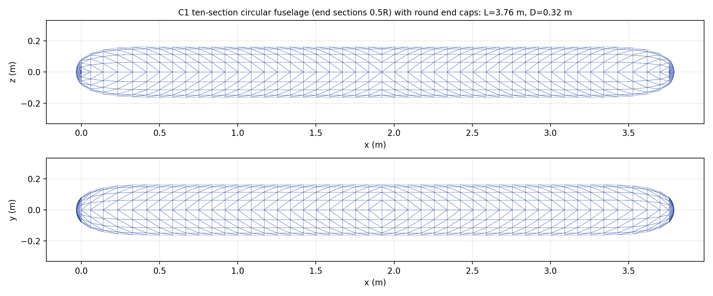
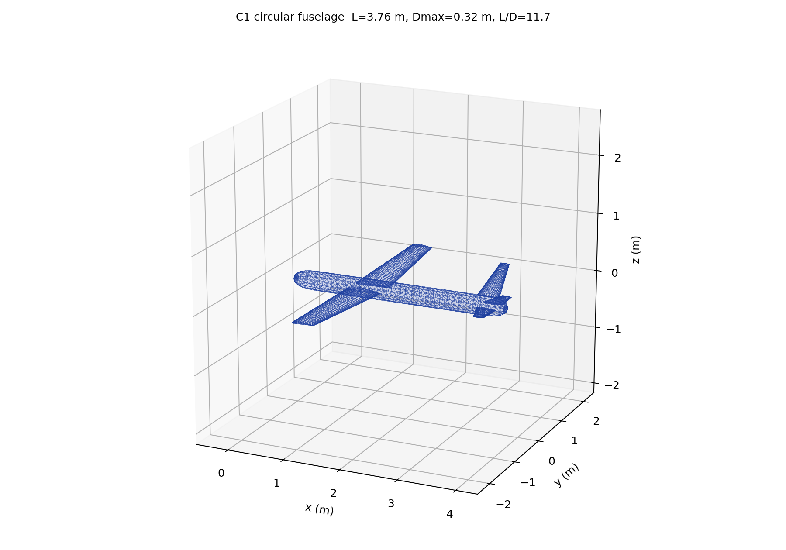

# Profili 翼型库集成与 AI 自动选型

## 1. 能力

- 从本机已安装的 **Profili 2.x** 读取翼型库（`InstLibraries/Profili.mdb`）；
- 本地缓存包含 **2200+ 个翼型**（名称、相对厚度、最大弯度、弯度位置、上下表面坐标）；
- AI 设计时按 **任务类型 / 雷诺数 / 马赫数 / 构型** 自动选择翼型；
- 选中的翼型以 Selig `.dat` 坐标导入 OpenVSP（`XS_FILE_AIRFOIL`），参与 VSPAERO 实际计算；
- LLM 可调用 `openvsp_list_airfoils` 查看候选，再把翼型名传给 `openvsp_build_aircraft`；未显式指定时后端自动选型。

## 2. 导入 Profili 库（本机）

Profili 是商业软件，**本仓库/安装包不包含 Profili 数据库**；只在用户本机从已授权安装导入本地缓存：

```powershell
powershell -ExecutionPolicy Bypass -File "<R2安装目录>\scripts\import_profili.ps1"
```

或指定数据库：

```powershell
powershell -ExecutionPolicy Bypass -File "<R2安装目录>\scripts\import_profili.ps1" `
  -MdbPath "<PROFILI_INSTALL>\InstLibraries\Profili.mdb" `
  -OutFile "$env:LOCALAPPDATA\OpenVSP-R2\airfoils\profili_library.json"
```

缓存默认位置：`%LOCALAPPDATA%\OpenVSP-R2\airfoils\profili_library.json`。

## 3. 自动选型规则

| 条件 | 任务类型 | 选型倾向 |
|---|---|---|
| 飞翼 / 无尾 | flying_wing | 反射翼型、低弯度、`MH/HS/PW/S5010/Horten` 等系列优先 |
| Ma ≥ 0.42 或巡航 ≥100 m/s | high_speed | 薄翼（约 8~12%）、低弯度（≤2~3%）、层流/6 系列 |
| Re < 1.8×10⁵ | low_re | 适度厚度（约 10~14%）、较高弯度（约 4~5%）|
| 展弦比大、低速电动 | endurance | 中等厚度、3% 左右弯度、低阻 |
| 其余 | general | 11~12% 厚度、约 3% 弯度 |

评分使用厚度、弯度、弯度位置、名称/系列匹配与任务惩罚项；实际气动优劣以 VSPAERO 结果为准。

## 4. 已验收样例

25 kg 常规电动无人机（25 m/s、1000 m、翼展≤4.5 m，离线模式）：

- 库：2201 个翼型（本机 Profili）
- 估算：Re≈4.75×10⁵，Ma≈0.074
- 自动选择：**EPPLER 332**（t/c=11.5%，camber=3.0%）
- 已导入 OpenVSP，VSPAERO：CLmax=1.044，L/Dmax=24.68
- 报告：`validation/airfoil_auto_test/design_report_*.docx`

## 5. 限制

- 没有 Profili 安装或未导入缓存时，自动降级到内置公开 NACA 4 位翼型；
- 选型评分当前主要基于几何/系列特征，未把 Profili 极曲线全部纳入；最终性能由 VSPAERO 实算；
- Profili 数据仅缓存于本机，不随 R2 便携包分发，避免商业数据再分发问题。

---

# 附：机身规则（十截面圆筒，首尾半半径 + 圆形端盖）

## 最终几何要求

- 机身只有 **10 个截面**；
- 10 个截面全部为 **圆**；
- 首、尾两个截面半径为 **0.5R**；其余 8 个截面半径为 **R**；
- 截面位置严格均匀：`x/L = 0, 1/9, 2/9, …, 1.00`；
- 首端封盖：`ROUND_END_CAP`（圆形端盖）；
- 尾端封盖：`ROUND_END_CAP`（圆形端盖）；
- 飞翼构型默认**不生成独立机身**，只保留翼身融合的机翼；只有显式指定 `fuselage_style` 时才生成中央体。



## 机身长度经验

采用总体设计常用统计范围：

| 参数 | 常用范围 | 本项目 |
|---|---|---|
| 常规机身长度/翼展 | 0.70~0.80 | **0.82**（略长） |
| V 尾机身长度/翼展 | 0.70~0.82 | **0.84** |
| 高空长航时 | 约 0.72~0.80 | **0.78** |
| 机翼前缘位置 | 22%~30% L | **27% L** |
| 尾臂/平均气动弦 | 2.5~3.0 MAC | 2.6 MAC + 0.10b，再按尾容量/重心/焦点修正 |

参考 Raymer《Aircraft Design: A Conceptual Approach》、Roskam《Airplane Design》以及公开 UAV 概念设计资料。

长度同时要满足：

```text
L ≥ 机头 + 机翼根弦 + 尾臂 + 尾翼弦 + 尾端余量
```

若尾翼气动中心不足目标焦点位置，则优先加长尾段。

## C1 结果

| 参数 | 优化前 | 当前 |
|---|---:|---:|
| 机身长度 | 3.22 m | **3.76 m** |
| 机头长度 | 0.46 m | **1.01 m（27% L）** |
| 机翼前缘 x | 0.46 m | **1.01 m** |
| 截面数量 | 5→32 变动 | **固定 10** |
| 截面 | 圆 | **圆，等半径** |
| 端盖 | 平端 | **首尾圆形端盖** |

## 其他案例

| 案例 | 机身 |
|---|---|
| C1 常规 25 kg | L 3.76 m，D 0.32 m，10 个圆截面（首尾 0.5R），圆形端盖 |
| C2 飞翼 15 kg | **无独立机身**（仅机翼） |
| C3 高速 120 kg | L 4.73 m，D 0.35 m，10 个圆截面（首尾 0.5R），圆形端盖 |
| C4 高空 60 kg | L 7.40 m，D 0.40 m，10 个圆截面（首尾 0.5R），圆形端盖 |

AI 工具：`openvsp_list_fuselage_styles` 返回 `circular_profile`；
`openvsp_build_aircraft` 可传 `fuselage_style="circular_profile"`；
飞翼默认不建机身。

---

# 附：翼根/平尾根裁剪（VSPAERO 暴露气动面）

针对“翼根和平尾根内嵌在机身内，但 VSPAERO 薄面模型仍按完整翼面计算”的问题，增加：

```python
spec.trim_roots_to_fuselage = True   # 默认开启
```

## 处理步骤

1. 取机翼/平尾根弦所在 x 处的机身局部半径 `R_f(x)`；
2. 根部 Y 偏移：
   ```text
   Y_root = R_f(x) + 6 mm
   ```
3. 缩短展长，保持翼尖位置不变；
4. 按线性收缩计算外移后的根弦：
   ```text
   c_exp = c_root - (c_root - c_tip) · Y_root / (b/2)
   ```
5. 按后掠/上反修正暴露根前缘 X/Z；
6. 计算暴露面积、暴露展长、暴露展弦比；
7. VSPAERO 使用暴露后的机翼/平尾；
8. 报告同时给出“完整几何面积”和“暴露气动面积”。



## C1 裁剪结果

| 部件 | 完整面积 | 暴露面积 | 根部 Y 偏移 |
|---|---:|---:|---:|
| 机翼 | 0.780 m² | 0.661 m² | 0.167 m |
| 平尾 | 0.113 m² | 0.049 m² | 0.158 m |

- 机翼暴露面积约为完整面积的 **84.7%**；
- 平尾暴露面积约为完整面积的 **43.7%**；
- 参考面积 `Sref` 仍采用完整机翼面积，避免与升力系数定义混用；
- 报告新增“参考面积约定”说明。

## 对结果的影响

- CLmax 从完整翼面模型的偏乐观值下降；
- 平尾有效面积明显减少，静稳定裕度需按暴露平尾重新评估；
- 由于 `Sref` 仍为完整机翼面积，CL 的定义保持一致；
- 仍然没有计入机身遮挡、翼身干扰和寄生阻力，属于概念设计级修正。

关闭该功能：

```python
DesignSpec(..., trim_roots_to_fuselage=False)
```

---

# 附：垂尾容量校核与机身半径设计准则

## 垂尾大小计算验证

以默认 C1（25 kg、翼展约 2.65 m）为例：

| 参数 | 修正前 | 修正后 |
|---|---:|---:|
| 垂尾面积 | 0.0699 m² | 0.0550 m² |
| 垂尾展长 | 0.392 m | 0.348 m |
| 垂尾容量系数 Vv | 0.0445 | 0.0350 |
| Cnβ | — | +0.083 /rad |
| Cyβ | — | -0.169 /rad |

结论：

- Vv=0.0445 偏高，视觉上确实会显得垂尾较大；
- 按目标 `Vv=0.035` 修正后，面积减少约 21%；
- Cnβ=+0.083/rad，仍为正，航向静稳定；
- 该值在小型无人机常用范围内，不是“越大越稳”，过大只会增加湿面积、侧力和重量；
- 修正逻辑已写入 `size_aircraft`，目标取自 `DesignSpec.tail_volume_v`。

## 中间截面半径设计准则

半径不再只用 `0.055·MTOW^(1/3)`，而是取三个约束的最大值：

### 1. 质量统计半径

```text
r_m = 0.055 · MTOW^(1/3) · 工况修正
```

修正：喷气/涡桨 ×0.82、高速 ×0.85、高空 ×0.92、大载荷 ×1.12、低速 ×1.03。

### 2. 内部容积半径

```text
r_v = sqrt((m_payload/250 + 0.02) / (π·L))
```

保证载荷、设备、电池有基本容积。

### 3. 长径比半径

```text
r_f = L / (2·(L/D)_limit)
```

- 常规/V 尾/喷气：`(L/D)_limit = 12`
- 高空长航时：14
- 飞翼：8

最终：

```text
r = max(r_m, r_v, r_f)
```

因此机身不能只按重量长成“胖圆筒”，也不能为了长而变成“细针”；中段半径和长度互相约束。

## 机身长度设计准则

- 常规：`L=0.82·b`
- V 尾：`L=0.84·b`
- 高空：`L=0.78·b`
- 飞翼中央体：`L=0.52·b`
- 机翼前缘：约 27% L
- 尾臂：`2.6·MAC + 0.10b`，再由尾容量和重心/焦点修正

C1 默认方案：L=2.213 m，D=0.322 m，L/D=6.88；按质量半径控制，整体在常用短舱机身范围内。较大翼展的 C1 方案 L/D 会被限制在约 11.7，不会无限细长。

报告几何参数表新增：

- 垂尾容量系数 Vv；
- 垂尾容量目标；
- Cnβ / Cyβ；
- 机身半径依据（质量/容积/长径比取最大值）。

限制：这些是概念设计级统计/几何约束，不能替代尾翼气动优化、结构布置和风洞/CFD 校核。

---

# 附：经验设计准则、飞行品质与多轮迭代

新增 `ai/ai_design/criteria.py`，在 VSPAERO 分析后自动检查五类约束，并参与设计迭代。

## 1. 机翼设计约束

| 参数 | 经验范围/准则 | 当前 C1 |
|---|---|---|
| 翼载 W/S | 15~90 kg/m²（小型 UAV） | 18.8 kg/m² |
| 展弦比 AR | 4~20；常规无人机常用 6~12 | 9.0 |
| 梢根比 λ | 0.35~0.70 | 0.60 |
| 上反角 | -2°~6°；低速常规常用 2°~4° | 2.0° |
| 失速速度 | `V_s=sqrt(2W/(ρSCLmax))`，需 ≤ 最小速度/1.15 | 20.6 m/s，通过 |
| 后掠角 | 由巡航 Ma 和结构决定，VSPAERO 中检查法向马赫数 | 0° |

## 2. 尾翼/垂尾容量约束

- 平尾容量：
```text
Vh = Sh·lh / (S·MAC)
```
目标 0.35~0.80（常规 0.4~0.8）。

- 垂尾容量：
```text
Vv = Sv·lv / (S·b)
```
目标 0.03~0.05；本工具会按实际尾臂自动修正到目标值。

- 平尾展弦比 2.5~6.0；垂尾展弦比 1.2~3.5。

C1 最终结果：

| 参数 | 结果 |
|---|---:|
| Vh | 0.638 |
| Vv | 0.035 |
| Cnβ | +0.075 /rad |
| Cyβ | -0.156 /rad |
| Clβ | -0.055 /rad |

## 3. 静稳定性与飞行品质

| 项目 | 估算公式/方法 | 目标 |
|---|---|---|
| 静稳定裕度 | Xnp - Xcg | 5%~20% MAC，目标 10% |
| 短周期 | 二自由度纵向矩阵特征值 | ζ 0.25~2.0，ωn 0.5~10 rad/s |
| 长周期 | `ωn≈sqrt(2)g/V`，`ζ≈(CD/CL)/sqrt(2)` | ζ 0.02~0.30 |
| 荷兰滚 | 简化横向矩阵/导数估算 | ζ>0.05，ωn 0.2~3 rad/s |
| 滚转模态 | 由 Clp 和 Ixx 估算时间常数 | <1.5 s |
| 螺旋稳定性 | Clβ<0 且 Cnβ>0 的趋势判断 | 稳定趋势 |

说明：短周期/荷兰滚/滚转为概念级简化估算，不能替代专项飞行动力学软件或试飞。

## 4. 操纵性

- 升降舵功率：由 Vh 估算，要求 >0.3；
- 方向舵功率：由 Vv 估算，要求 >0.02；
- 副翼滚转功率：由翼展/弦长估算，要求 >0.02；
- 俯仰配平能力指标：由 CLα/|CMα| 估算，要求 >5。

## 5. 多轮设计迭代

离线流程新增准则驱动迭代：

1. 初次 sizing + OpenVSP + VSPAERO；
2. 评估 25 项准则；
3. 若失速、尾容量或上反角不满足，调整 `wing_area_m2`、`tail_volume_h/v` 或 `dihedral_deg`；
4. 重建几何并重新运行 VSPAERO；
5. 最多 2 轮修正，记录每轮面积、翼展、准则通过/警告/失败；
6. 最终报告输出迭代表。

C1 实测：

| 轮次 | 机翼面积 | 翼展 | 准则结果 |
|---|---:|---:|---|
| 0 | 0.780 m² | 2.650 m | 24 通过 / 1 警告 |
| 1 | **1.333 m²** | **3.463 m** | **25 通过 / 0 警告** |

失速速度从 28.1 m/s 降到 20.6 m/s，满足最小速度 25 m/s、失速裕度 1.15 的要求；机翼面积增加后，CLmax 与升阻比按新几何重新计算。

## 6. 大模型接口

新增工具：

- `openvsp_evaluate_design`：返回全部准则检查、动态特性与操纵性结果；
- `openvsp_build_aircraft` 新增可覆盖参数：
  - `taper_ratio`
  - `sweep_deg`
  - `dihedral_deg`
  - `tail_volume_h`
  - `tail_volume_v`
  - `trim_roots_to_fuselage`

LLM 可先查翼型/机身规则，再按准则设定机翼/尾翼参数，分析后调用 `openvsp_evaluate_design`，依据警告项迭代修改。

## 7. 报告新增内容

稳定性与操纵性章节新增：

- 表 5-1 机翼参数与经验约束；
- 表 5-2 尾翼参数与尾容量；
- 表 5-3 静稳定性参数；
- 表 5-4 飞行品质与动态稳定性估算；
- 表 5-5 操纵性估算；
- 表 5-6 未通过/需关注的准则；
- 表 6-1 准则驱动设计迭代与 VSPAERO 复算。

这些参数与结论已自动写入 Word 报告。

