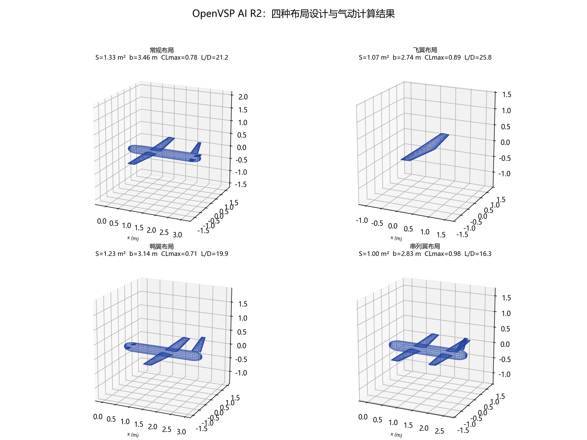
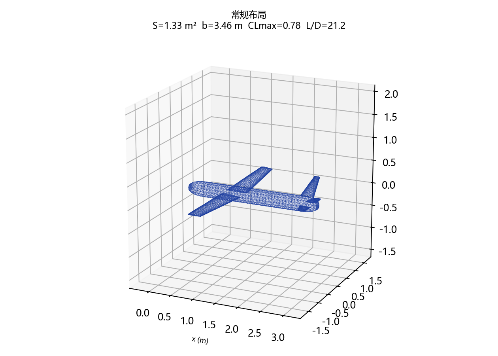
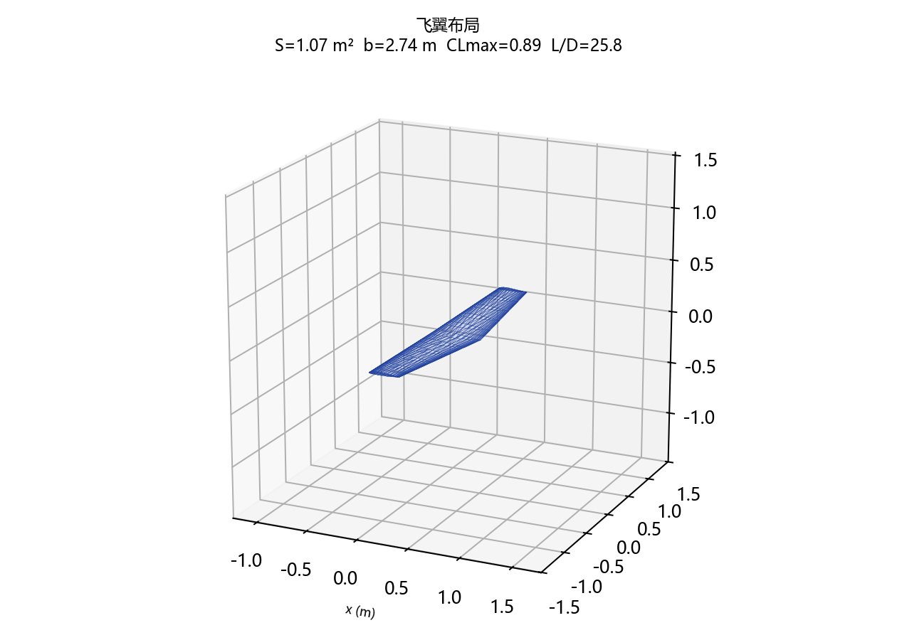
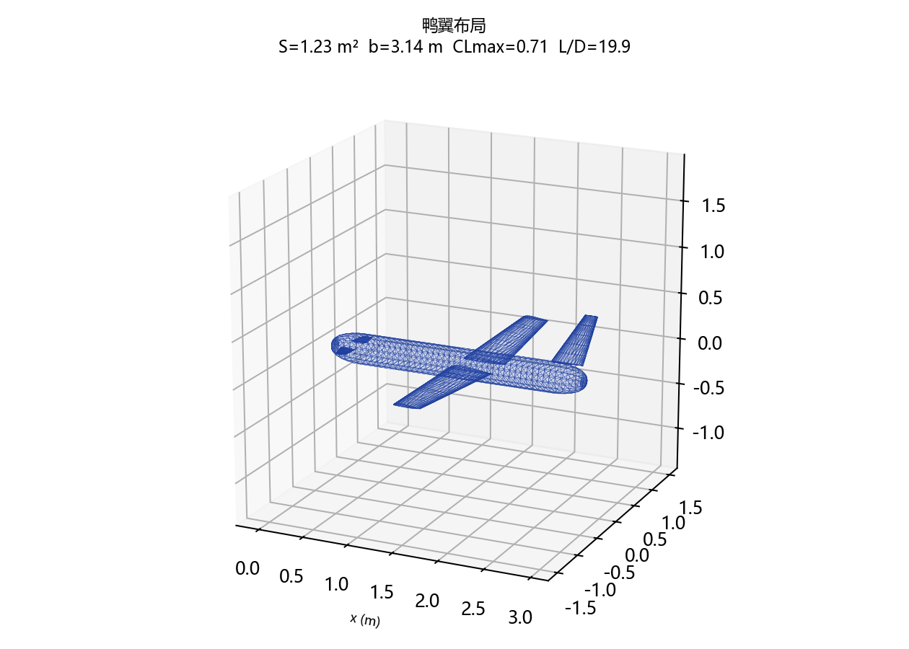
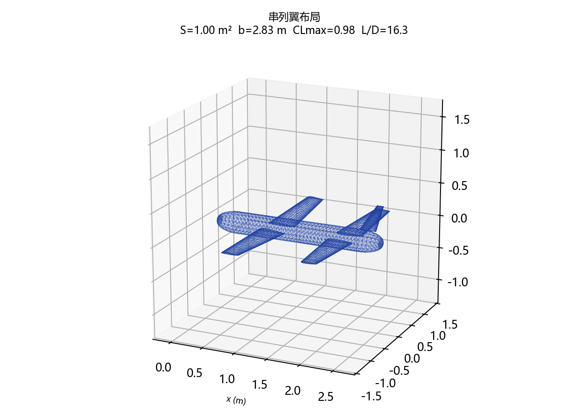

# 四布局设计与测试（常规 / 飞翼 / 鸭翼 / 串列翼）

## 1. 测试设置

四个方案使用相近任务输入：

- 最大起飞重量：25 kg
- 海拔：1000 m
- 巡航速度：25 m/s
- 有效载荷：5 kg
- 电动动力
- 翼展/展弦比按布局需求设置

统一流程：

```text
需求解析 → 经验准则 sizing → OpenVSP 建模
→ VSPAERO 定常气动 + 稳定性导数
→ 准则评估与迭代 → 导出 STL / 报告
```

新增支持：

- `configuration = "canard"`：鸭翼在前、主翼在后、垂尾在尾部；
- `configuration = "tandem"`：前翼 + 后翼串列、垂尾在尾部；
- 飞翼仍默认不生成独立机身；
- 工具 schema 和自然语言解析均支持新布局。

## 2. 外形截图



### 常规布局



### 飞翼布局



### 鸭翼布局



### 串列翼布局



## 3. 气动与准则结果

| 布局 | 机翼面积 | 翼展 | CLmax | (L/D)max | 静稳定裕度 | 准则通过/警告/失败 |
|---|---:|---:|---:|---:|---:|---|
| 常规 | 1.33 m² | 3.46 m | 0.779 | 21.22 | 10.0% | **25 / 0 / 0** |
| 飞翼 | 1.07 m² | 2.74 m | 0.886 | 25.80 | 10.0% | 15 / 3 / 0 |
| 鸭翼 | 1.23 m² | 3.14 m | 0.706 | 19.94 | 10.0% | 18 / 2 / 0 |
| 串列翼 | 1.00 m² | 2.83 m | 0.985 | 16.31 | 10.0% | 21 / 1 / 0 |

说明：

- 飞翼升阻比最高，但没有独立垂尾，`Cnβ`、`Cyβ` 很小，航向稳定性不足；
- 鸭翼方案静稳定裕度按目标 10% 配平，但仍出现失速速度（22.55 m/s）和 `CMα` 偏正的警告，需要进一步调整鸭翼面积/安装角、主翼位置或机翼面积；
- 串列翼方案 CLmax 约 0.98、升阻比约 16.3；仅剩俯仰配平指标偏低（2.58，要求>5），需要调整后翼位置或升降舵；
- 常规布局 25 项准则全部通过；鸭翼和串列翼的根部也已按机身宽度进行 Y 偏移与暴露面积裁剪。

## 4. 结论

1. 常规布局是当前约束下最均衡的方案，适合作为基准；
2. 飞翼适合追求升阻比，但必须增加翼尖垂尾/阻力方向舵或主动偏航控制；
3. 鸭翼方案需要重新设计鸭翼容量和安装角，不能只靠移动重心达到稳定；
4. 串列翼升力面大、诱导阻力低，但纵向动态偏快，需要进一步优化后翼位置和惯量分布；
5. 当前结果均为 VSPAERO 概念设计级，不能替代 CFD/风洞/试飞。

## 5. 输出文件

每个布局目录均包含：

- `design_model.vsp3`
- `design_model.stl`
- `design_report_*.docx`
- `fig_*.png`
- `results.json`

目录：`validation/layouts/<layout>/`
